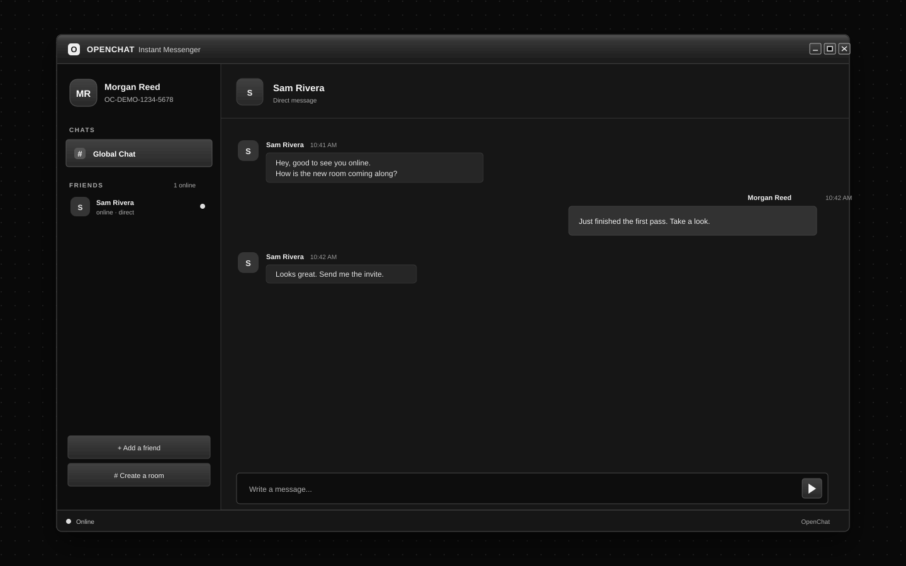
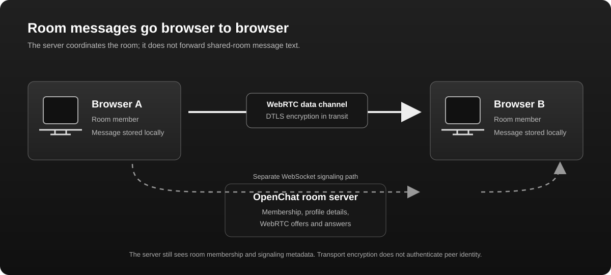
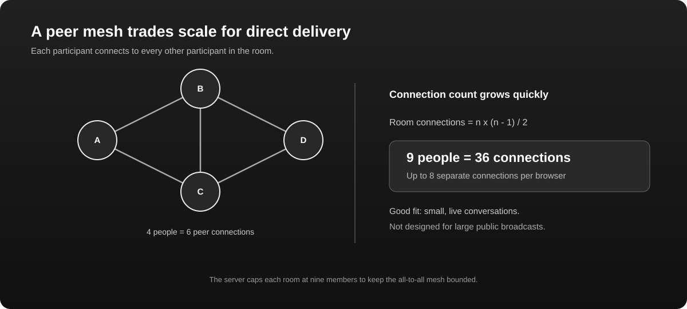
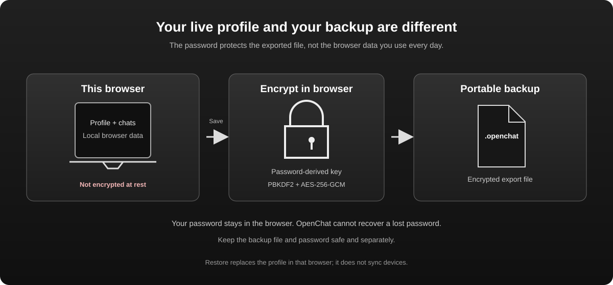

# OpenChat

**A self-hosted instant messenger with a little early-2000s desktop nostalgia and a browser-to-browser chat architecture.**

OpenChat gives you a familiar buddy-list-and-chat-window experience without a hosted account system. Run the small Node.js server yourself, connect through a browser, and use Global Chat, create a room, or exchange a direct-message invitation with a friend.

> **Experimental software:** OpenChat is not an independently reviewed secure-messaging product. Read [Security and privacy](#security-and-privacy) before using it, and do not use it for sensitive communications.

[](https://github.com/thecathousemp3/OpenChat/actions/workflows/ci.yml)
[](LICENSE)
[](https://nodejs.org/)



*An illustrated preview of the interface. Names and messages are fictional; this is not a live conversation.*

## Explore OpenChat

| How room messages travel | How peer meshes scale | What a profile backup protects |
| --- | --- | --- |
|  |  |  |

## At a glance

- **Global Chat and rooms:** room members connect to one another with WebRTC data channels. Global Chat is the only room present when a server starts; users can create other rooms.
- **Direct messages:** friends exchange a connection offer and answer out of band, then chat over a browser-to-browser data channel.
- **Friend requests:** connect with a friend code, check the code through a trusted channel, then accept or ignore the request.
- **Personal profiles:** choose a display name and picture. Profile information is sent to connected friends and room members.
- **Portable encrypted backup:** export your local profile, friends, requests, and cached messages to a password-protected `.openchat` file.
- **Self-hosted:** one small Node.js process serves the page and coordinates room membership and WebRTC signaling.

## Get started

### Requirements

- Node.js 22 or later
- npm
- A modern browser with WebRTC and Web Crypto support

### Run locally

```sh
git clone https://github.com/thecathousemp3/OpenChat.git
cd OpenChat
npm install
npm start
```

Open [http://localhost:3000](http://localhost:3000). Keep the Node.js process running while using shared chat.

To use a different address or port:

```sh
HOST=127.0.0.1 PORT=8080 npm start
```

PowerShell:

```powershell
$env:HOST = "127.0.0.1"
$env:PORT = "8080"
npm start
```

### Configure WebRTC connectivity

By default, OpenChat uses no STUN or TURN servers. You can provide ICE servers to every browser connected to your instance with `ICE_SERVERS_JSON`:

```sh
ICE_SERVERS_JSON='[{"urls":"stun:stun.example.org:3478"},{"urls":"turn:turn.example.org:3478?transport=udp","username":"temporary-user","credential":"temporary-password"}]' npm start
```

PowerShell:

```powershell
$env:ICE_SERVERS_JSON = '[{"urls":"stun:stun.example.org:3478"},{"urls":"turn:turn.example.org:3478?transport=udp","username":"temporary-user","credential":"temporary-password"}]'
npm start
```

The value must be a JSON array of ICE server objects. Each object has `urls` (a URL string or array); TURN entries also require `username` and `credential`. STUN can help peers discover reachable network addresses; TURN can relay encrypted WebRTC traffic when direct connections fail. Use a TURN provider you trust and short-lived credentials: the configuration, including TURN credentials, is delivered to browsers and is visible to users of your instance. The credentials are not a secret from those users. ICE servers can improve connectivity but do not guarantee a connection.

Run the test suite with `npm test`.

## A first tour

### Start with Global Chat

Every new server starts with one room: **Global Chat**. The room list and membership live in server memory. Creating a room makes it available to people connected to that same server; it does not publish the room to a global directory. Custom rooms disappear when the server restarts.

Room chat is a direct mesh: each browser creates a separate WebRTC data channel to every other currently connected member. The room server tells members who is present and helps browsers exchange connection offers and answers. It does not receive room message text. The app waits until a channel to every listed participant is open before sending a room message; messages are not queued for offline members.

Rooms have **no fixed participant cap**. Each browser connects directly to every other room member, so the full mesh grows quadratically: a room with *n* people needs *n × (n − 1) ÷ 2* peer connections overall. OpenChat will accept larger rooms, but browsers and networks have practical capacity limits; very large rooms may become slow or fail to connect. The [room mesh diagram](assets/room-mesh.svg) shows how the connection count grows.

### Add a friend and start a direct chat

1. Select **Add a friend** and exchange your `OC-XXXX-XXXX-XXXX` friend code through a channel you trust.
2. Follow the prompts in both browser sessions to create and exchange a connection offer and answer. These are connection setup details, not chat messages.
3. Compare the friend codes through that trusted channel. Codes help you check what you were given, but OpenChat does not cryptographically verify a person's identity.
4. Accept or ignore the incoming friend request. Once the WebRTC data channel is open, you can message directly.

Direct-message signaling is manual: OpenChat does not operate a direct-message signaling service. Existing friends and local history stay associated with the local profile when you generate a new invite code; the new code is what you share with new contacts.

### Choose a name and picture

Edit your local profile in the sidebar. When your browser is connected, the selected name and picture are shared with your connected friends and the participants in your current shared room. Those details are not verified: another participant or server can claim a display name or picture.

### Back up or restore your profile

Choose **Save profile** and set a password of at least 12 characters. The browser encrypts the export with **AES-256-GCM**. A key is derived from your password using **PBKDF2-HMAC-SHA-256 with 310,000 iterations**, a random 16-byte salt, and a random 12-byte GCM nonce. The `.openchat` file contains the encrypted backup and the parameters needed to derive its key; it does not contain your password.

Choose **Restore** and select the file and password. Restoring replaces the profile currently in that browser. OpenChat cannot recover a lost password. Keep the file and password somewhere safe and separately.

## What happens to a message?

### Shared-room message

1. The browser sends the server a join request with the selected room and profile details.
2. The server returns a temporary connection ID and room-member metadata, then relays WebRTC offers and answers between room members.
3. Browsers establish direct WebRTC data channels. The browser encrypts channel traffic in transit with DTLS.
4. The sender sends the room message over each open peer channel. The server does not relay the message body.

The server still sees room membership, profile details, invite codes, and connection signaling. A server that actively interferes with signaling could affect which peer connection is established. WebRTC's transport encryption is not a substitute for a reviewed, authenticated end-to-end encryption protocol.

### Direct message

Direct messages also travel over a WebRTC data channel protected in transit with DTLS, but their initial connection is established using manually exchanged offer and answer text. You are responsible for sharing those details and checking your friend's code through a trusted channel.

### Why WebRTC might not connect

WebRTC needs a path through the networks between the browsers. OpenChat ships with **no STUN or TURN servers configured**. The instance operator can configure them using [`ICE_SERVERS_JSON`](#configure-webrtc-connectivity):

- **STUN** can help a browser discover a network address that peers may be able to reach.
- **TURN** can relay traffic when a direct path is blocked. A TURN relay would carry encrypted transport data, but it adds an infrastructure operator and network dependency.
- Without either service, NATs, firewalls, VPNs, or browser network policies can prevent peers from connecting.

The app reports connection status and retries ICE negotiation for shared-room peer connections after a connection failure. Direct-message signaling is manual, so a failed direct connection requires exchanging a new offer and answer. The app does not silently fall back to sending room message text through the server. WebRTC may also expose network address information to peers or infrastructure involved in connection setup; consider this when deciding whether to use it.

## Local data and backup boundaries

OpenChat stores the active profile and recent conversation history in the browser's local storage. That data is **not encrypted at rest**. Someone with access to your unlocked browser profile or device may be able to read it.

The password-protected export is encrypted, but encryption applies to the exported file, not the live browser storage. Your password is not sent to the server, and there is no account-based recovery if the file or password is lost. A new device starts with a separate local profile unless you restore an export yourself.


## Architecture

- **`index.html`** contains the interface, local profile and conversation storage, profile export encryption, direct WebRTC setup, and room peer connections.
- **`server.js`** serves the page and ICE server configuration, and handles room discovery, membership, profile metadata, and room WebRTC offer/answer signaling. It does not relay shared-room message bodies.
- **`ws`** provides the WebSocket server. The browser uses built-in Web APIs for WebRTC, Web Crypto, and local storage.
- **No user database:** room names and membership are kept in server memory; profile and conversation state are kept separately in each browser profile.

### Why a peer mesh is for small groups

In a full mesh, every participant needs one connection to every other participant. With *n* members, that is *n × (n − 1) ÷ 2* peer connections across the room, and each participant maintains *n − 1* connections. This avoids routing message bodies through a central room server, but it uses more network and browser resources as a room grows. OpenChat imposes no fixed participant cap; actual capacity depends on each participant's browser, device, and network.

### What “self-hosted” and “peer-to-peer” mean here

You operate the room server, but room participants still depend on it to find room members and exchange connection setup data. The server is not a global user directory, and there is no central account or identity provider. Once connected, chat messages travel browser to browser. These properties reduce the server's role; they do not make the system anonymous, identity-proof, or immune to a malicious server.

## Security and privacy

OpenChat is an early-stage project and has not had an independent security review. Do not use it for sensitive communications or treat it as a secure-messaging product.

- **Transport encryption:** browsers protect WebRTC data channels with DTLS in transit. Shared-room message bodies are not sent through the OpenChat server.
- **Signaling and metadata:** the room server handles membership, names, pictures, invite codes, and WebRTC offers and answers. These are not end-to-end encrypted by an OpenChat identity protocol.
- **No cryptographic identity verification:** friend codes and profile details can be spoofed. A malicious or compromised signaling server could interfere with connection setup.
- **Unencrypted device storage:** active browser data is stored locally without encryption. Only exported profile files are encrypted.
- **No offline delivery:** messages are not queued for disconnected peers.
- **Optional STUN/TURN:** the server operator can configure ICE servers, but those services add infrastructure and privacy considerations; some network configurations may still fail to connect.
- **No moderation or access control:** anyone who can reach the server can join available rooms or create rooms. There are no accounts, room permissions, abuse reports, or admin console.
- **Network information:** WebRTC can expose network addresses to peers or infrastructure involved in connection establishment.

See [SECURITY.md](SECURITY.md) for reporting guidance and the current security boundaries.

## Hosting beyond your own computer

For access over the internet, place the Node.js server behind a reverse proxy that terminates HTTPS and supports WebSocket upgrades. Configure it to preserve the `Host` header. Visitors should use HTTPS; browsers require a secure context for some cryptographic and media-related APIs.

The server checks that a WebSocket `Origin` matches its `Host`, but this is **not authentication or authorization**. The included server has no accounts, permissions, persistence, moderation, resource quotas, or administrator console. Anyone who can reach it can join rooms on it. Review the code and add the operational safeguards appropriate to your deployment before sharing it publicly.

## Development

There is no build step. The CI workflow checks JavaScript syntax, runs the server integration tests, and audits production dependencies.

```sh
npm test
node --check server.js
npm audit --omit=dev
```

Contributions are welcome. Open an issue to discuss a substantial change before starting work, and include reproduction steps and relevant environment details in bug reports. Do not post real invite codes, profile backups, passwords, or message contents.

## Project status and credits

OpenChat is an independent experimental project. It is not affiliated with AOL or Signal. The interface takes broad inspiration from classic desktop instant messengers; no third-party product code or artwork is included.

## License

OpenChat is available under the MIT License. See [LICENSE](LICENSE).
