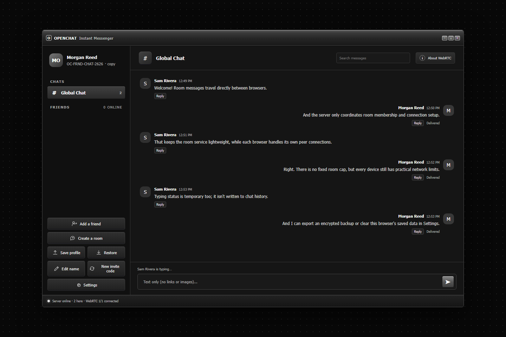
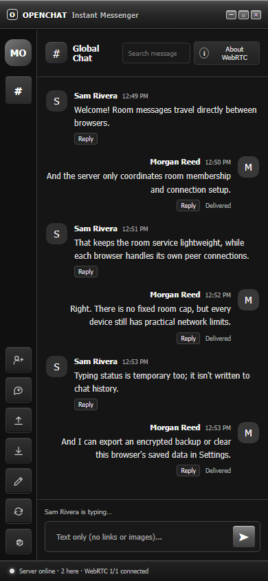

# OpenChat

**A self-hosted, monochrome pixel-style, text-only messenger with early-2000s desktop nostalgia and a browser-to-browser chat architecture.**

Run a small Node.js signaling server on a computer you control, then open it in a current browser. Global Chat and custom rooms connect participants directly over WebRTC; the server coordinates discovery and connection setup but does not relay shared-room message bodies. Friends can establish direct-message channels by exchanging connection details out of band. There is no hosted account system, global server directory, or central message database.

> **Experimental software:** OpenChat is not an independently reviewed secure-messaging product. Read [Security and privacy](#security-and-privacy) before using it, and do not use it for sensitive communications.

[](https://github.com/thecathousemp3/OpenChat/actions/workflows/ci.yml)
[](LICENSE)
[](https://nodejs.org/)



*Desktop capture of the running app with fictional sample profiles and messages; it is a product screenshot, not a live conversation.*



*The same interface at a narrow mobile viewport. Captures can be regenerated with `npm run capture:screenshots`.*

## Explore OpenChat

| How room messages travel | How peer meshes scale | What a profile backup protects |
| --- | --- | --- |
|  |  |  |

## At a glance

- **Global Chat and rooms:** room members connect to one another with WebRTC data channels. Global Chat is the only room present when a server starts; users can create other rooms.
- **Direct messages:** friends exchange a connection offer and answer out of band, then chat over a browser-to-browser data channel.
- **Friend requests:** connect with a friend code, check the code through a trusted channel, then accept or ignore the request.
- **Delivery feedback:** messages show per-peer delivery acknowledgements; undelivered messages can be retried without re-sending to peers that acknowledged them.
- **Plain-text chat:** message bodies are displayed as text only. Markup and URLs are not rendered as HTML, images, or clickable links.
- **Typing status:** a compact, temporary indicator shows when room participants are typing. Typing notices travel over the existing peer-to-peer data channels and are not saved.
- **Local conversation tools:** search the messages cached on this device and reply to a message with a quoted excerpt.
- **Personal profiles:** choose a display name and picture. Profile information is sent to connected friends and room members.
- **Portable encrypted backup:** export your local profile, friends, requests, and cached messages to a password-protected `.openchat` file.
- **Connection status:** see whether this instance is reachable and how many live members are in each room.
- **Browser data controls:** clear the OpenChat profile and conversation data stored by this browser from Settings.
- **Self-hosted:** one small Node.js process serves the page and coordinates room membership and WebRTC signaling.
- **IRC-style chat commands:** use `/help`, `/who`, `/me <action>`, and `/clear` in the message box.

See the [feature tracker](FEATURES.md) for a direct comparison with BitChat's documented feature set, current implementation status, and a tracked sequence for the remaining platform-dependent work. Repository changes are recorded in [CHANGELOG.md](CHANGELOG.md).

## How it works—and why

OpenChat separates **coordination** from **conversation**:

1. A browser opens a WebSocket to the server instance chosen by the user and asks to join a room.
2. The server keeps that instance's room membership in memory, returns the current members, and relays WebRTC connection offers and answers. It sees names, profile pictures, invite codes, and signaling metadata.
3. Each pair of room members negotiates a WebRTC data channel. ICE tries available network paths; an operator may configure STUN and TURN servers when direct connectivity needs help.
4. Message bodies, typing notices, and delivery acknowledgements travel over those peer data channels. The room server does not receive or forward message text.
5. Each browser stores its own profile and recent conversation history. There is no server-side message history or offline queue.

| Choice | Why it fits this project | Trade-off |
| --- | --- | --- |
| A small Node.js signaling server and browser-native APIs | One self-hosted process avoids a separate application service, user database, and compiled frontend. JavaScript handles the coordination workload; browsers provide WebSocket, WebRTC, Web Crypto, and local storage. | The operator still runs a reachable server for room discovery/signaling. Node.js is not a defense against all connection floods; public deployments need proxy-level connection and IP limits. |
| WebRTC peer-to-peer room mesh | Message bodies go directly between participants instead of through a central room-message relay. This keeps the server's role smaller and matches the self-hosted model. | Every participant maintains a connection to every other participant. With *n* people, each browser handles *n − 1* connections and the room has *n × (n − 1) ÷ 2* connections overall. Rooms have no fixed participant cap, but device, browser, and network capacity still impose practical limits. |
| Text-only, bounded message bodies | A 500-character plain-text message keeps chat focused and rendering simple. HTML is never interpreted, and URLs are not converted into links or previews, so chat content cannot embed active markup or images. | Images, file attachments, rich formatting, and clickable links are intentionally not part of a message. Profile pictures are separate profile metadata, not message content. |
| Optional STUN/TURN instead of a bundled relay | Operators choose the network services appropriate for their deployment; no external ICE provider is silently selected by default. STUN can help discover paths, while TURN can relay transport when direct paths fail. | ICE settings are sent to browsers. TURN adds a service and trust boundary, and credentials should be short-lived. These options improve connectivity but cannot guarantee it. |
| Local browser storage with an encrypted export | A self-hosted service does not need a central profile database. Users can export a password-protected backup and clear this origin's saved data from Settings. | Active local storage is not encrypted at rest, is tied to this browser, and is not synchronized. Exported backups are encrypted; losing their password means they cannot be restored. |

These are deliberate scope choices, not claims that the system is unlimited or anonymous. There is no global directory: a room count and connection indicator describe only the instance currently open in that browser. Typing notices are short-lived room signals; they are not saved to message history, but current room peers can see them. WebRTC transport encryption protects data in transit, but OpenChat does not authenticate identities with a cryptographic end-to-end protocol; see [Security and privacy](#security-and-privacy).

## Get started

### Requirements

- Node.js 22 or later
- npm
- A supported browser with WebRTC, Web Crypto, and local storage support

### Browser support

OpenChat targets current stable desktop Chrome, Edge, Firefox, and Safari. Chromium is exercised in the automated browser integration test; the other browsers are best-effort targets and should be tested before relying on a deployment. Mobile browsers may work but are not currently covered by automated tests. Use an up-to-date browser; WebRTC and Web Crypto behavior, and available network paths, vary by browser and environment.

### Quick start by device

Download and extract the [repository ZIP](https://github.com/thecathousemp3/OpenChat/archive/refs/heads/main.zip), or clone the repository, then run the launcher for your computer:

| Platform | Launcher |
| --- | --- |
| Windows | [start-windows.bat](start-windows.bat) |
| macOS | [start-macos.command](start-macos.command) |
| Linux | [start-linux.sh](start-linux.sh) |
| Phone or tablet | [Mobile quick start](START-MOBILE.md) |

The desktop launchers check for Node.js 22 or later, install the locked dependencies if needed, and start the server. Keep the terminal window open while using OpenChat. On macOS, if double-clicking the `.command` file is blocked, run `bash ./start-macos.command` from Terminal in the extracted folder. On Linux, run `bash ./start-linux.sh` from the extracted project folder (or make it executable once with `chmod +x ./start-linux.sh` and then run `./start-linux.sh`).

OpenChat runs in a mobile browser; it does not currently have a native mobile app or a public hosted instance. See the [mobile quick start](START-MOBILE.md) for how to connect a phone to a self-hosted instance.

### Quick start by device

Download and extract the [repository ZIP](https://github.com/thecathousemp3/OpenChat/archive/refs/heads/main.zip), or clone the repository, then run the launcher for your computer:

| Platform | Launcher |
| --- | --- |
| Windows | [start-windows.bat](start-windows.bat) |
| macOS | [start-macos.command](start-macos.command) |
| Linux | [start-linux.sh](start-linux.sh) |
| Phone or tablet | [Mobile quick start](START-MOBILE.md) |

The desktop launchers check for Node.js 22 or later, install the locked dependencies if needed, and start the server. Keep the terminal window open while using OpenChat. On macOS, if double-clicking the `.command` file is blocked, run `bash ./start-macos.command` from Terminal in the extracted folder. On Linux, run `bash ./start-linux.sh` from the extracted project folder (or make it executable once with `chmod +x ./start-linux.sh` and then run `./start-linux.sh`).

OpenChat runs in a mobile browser; it does not currently have a native mobile app or a public hosted instance. The landing page is informational and does not change the app's network requirements. See the [mobile quick start](START-MOBILE.md) for how to connect a phone to a self-hosted instance.

### Run locally

```sh
git clone https://github.com/thecathousemp3/OpenChat.git
cd OpenChat
npm install
npm start
```

Open [http://localhost:3000](http://localhost:3000) for the project landing page, then choose **Launch OpenChat** or go directly to [http://localhost:3000/app](http://localhost:3000/app). Keep the Node.js process running while using shared chat.

The landing page includes the room message-path diagram, peer-mesh scaling guide, setup steps, and a clear status for browser and native transports.

To use a different address or port:

```sh
HOST=127.0.0.1 PORT=8080 npm start
```

PowerShell:

```powershell
$env:HOST = "127.0.0.1"
$env:PORT = "8080"
npm start
```

For IPv6, bind the server to the IPv6 wildcard address. Node.js and the browser handle IPv6 WebRTC candidates as part of normal ICE negotiation:

```powershell
$env:HOST = "::"
npm start
```

### Configure WebRTC connectivity

By default, OpenChat uses no STUN or TURN servers. Configure ICE servers for every browser connected to your instance with `ICE_SERVERS_JSON`:

```sh
ICE_SERVERS_JSON='[{"urls":"stun:stun.example.org:3478"},{"urls":"turn:turn.example.org:3478?transport=udp","username":"temporary-user","credential":"temporary-password"}]' npm start
```

PowerShell:

```powershell
$env:ICE_SERVERS_JSON = '[{"urls":"stun:stun.example.org:3478"},{"urls":"turn:turn.example.org:3478?transport=udp","username":"temporary-user","credential":"temporary-password"}]'
npm start
```

The value must be a JSON array of ICE server objects. Each object has `urls` (a URL string or array); TURN entries also require `username` and `credential`. STUN can help peers discover reachable network addresses; TURN can relay encrypted WebRTC traffic when direct connections fail. Use a TURN provider you trust and short-lived credentials: the configuration, including TURN credentials, is delivered to browsers and is visible to users of your instance. The credentials are not a secret from those users. ICE servers can improve connectivity but do not guarantee a connection.

Run the test suite with `npm test`.

## A first tour

### Start with Global Chat

Every new server starts with one room: **Global Chat**. The room list and membership live in server memory. Creating a room makes it available to people connected to that same server; it does not publish the room to a global directory. Custom rooms disappear when the server restarts.

The room list displays current member counts, and the status bar and Settings report whether the configured server is connected or reconnecting. This is visibility into the single server instance you opened; OpenChat does not discover or monitor unrelated servers.

Room chat is a direct mesh: each browser creates a separate WebRTC data channel to every other currently connected member. The room server tells members who is present and helps browsers exchange connection offers and answers. It does not receive room message text. A message is sent to currently open peer channels; OpenChat shows which peers acknowledged it and lets you retry unacknowledged recipients. Messages are not queued for offline members, and older clients that do not acknowledge messages may leave the delivery status waiting.

Rooms have **no fixed participant cap**. Each browser connects directly to every other room member, so the full mesh grows quadratically: a room with *n* people needs *n x (n - 1) / 2* peer connections overall. OpenChat will accept larger rooms, but browsers and networks have practical capacity limits; very large rooms may become slow or fail to connect. The [room mesh diagram](assets/room-mesh.svg) shows how the connection count grows.

Search applies only to the conversation history cached in the current browser profile. Replies store a quoted excerpt locally and send that excerpt with the reply; there is no server-side search, synchronized history, or offline delivery. The server has no accounts, room permissions, or moderation tools, so any reachable visitor can join a room. Since participant identities are not authenticated, OpenChat does not currently assign trusted room moderators.

### Add a friend and start a direct chat

1. Select **Add a friend** and exchange your `OC-XXXX-XXXX-XXXX` friend code through a channel you trust.
2. Follow the prompts in both browser sessions to create and exchange a connection offer and answer. These are connection setup details, not chat messages.
3. Compare the friend codes through that trusted channel. Codes help you check what you were given, but OpenChat does not cryptographically verify a person's identity.
4. Accept or ignore the incoming friend request. Once the WebRTC data channel is open, you can message directly.

Direct-message signaling is manual: OpenChat does not operate a direct-message signaling service. Existing friends and local history stay associated with the local profile when you generate a new invite code; the new code is what you share with new contacts.

### Choose a name and picture

Edit your local profile in the sidebar. When your browser is connected, the selected name and picture are shared with your connected friends and the participants in your current shared room. Those details are not verified: another participant or server can claim a display name or picture.

### Use chat commands

The message box supports a small set of familiar IRC-style commands:

- `/help` shows the available commands.
- `/who` lists participants connected to the current conversation.
- `/me <action>` sends an action message, such as `/me waves`.
- `/clear` clears the current conversation history from this browser only. It does not delete copies stored by other participants.

### Back up or restore your profile

Choose **Save profile** and set a password of at least 12 characters. The browser encrypts the export with **AES-256-GCM**. A key is derived from your password using **PBKDF2-HMAC-SHA-256 with 310,000 iterations**, a random 16-byte salt, and a random 12-byte GCM nonce. The `.openchat` file contains the encrypted backup and the parameters needed to derive its key; it does not contain your password.

Choose **Restore** and select the file and password. Restoring replaces the profile currently in that browser. OpenChat cannot recover a lost password. Keep the file and password somewhere safe and separately.

## What happens to a message?

### Shared-room message

1. The browser sends the server a join request with the selected room and profile details.
2. The server returns a temporary connection ID and room-member metadata, then relays WebRTC offers and answers between room members.
3. Browsers establish direct WebRTC data channels. The browser encrypts channel traffic in transit with DTLS.
4. The sender sends the room message over each open peer channel. The server does not relay the message body.

The server still sees room membership, profile details, invite codes, and connection signaling. A server that actively interferes with signaling could affect which peer connection is established. WebRTC's transport encryption is not a substitute for a reviewed, authenticated end-to-end encryption protocol.

### Direct message

Direct messages also travel over a WebRTC data channel protected in transit with DTLS, but their initial connection is established using manually exchanged offer and answer text. You are responsible for sharing those details and checking your friend's code through a trusted channel.

### Why WebRTC might not connect

WebRTC needs a path through the networks between the browsers. OpenChat ships with **no STUN or TURN servers configured**. The instance operator can configure them using [`ICE_SERVERS_JSON`](#configure-webrtc-connectivity):

- **STUN** can help a browser discover a network address that peers may be able to reach.
- **TURN** can relay traffic when a direct path is blocked. A TURN relay would carry encrypted transport data, but it adds an infrastructure operator and network dependency.
- Without either service, NATs, firewalls, VPNs, or browser network policies can prevent peers from connecting.

The app reports connection status and retries ICE negotiation for shared-room peer connections after a connection failure. Direct-message signaling is manual, so a failed direct connection requires exchanging a new offer and answer. The app does not silently fall back to sending room message text through the server. WebRTC may also expose network address information to peers or infrastructure involved in connection setup; consider this when deciding whether to use it.

### Voice/video and end-to-end security

Voice and video calling are not implemented yet. WebRTC media uses DTLS-SRTP transport encryption, but OpenChat does not cryptographically authenticate peer identities or protect signaling with an identity-key protocol. Therefore, transport encryption alone is not a verified end-to-end encryption guarantee against a malicious signaling service. Voice/video and stronger authenticated end-to-end security need a separate threat model, protocol and key-verification design, and independent security review before implementation or security claims.

See the [voice/video security design](CALLS_SECURITY_DESIGN.md) for the threat model and implementation gates. It defines no protocol yet; a mature, reviewed approach and independent security review are prerequisites.

## Local data and backup boundaries

OpenChat stores the active profile and recent conversation history in the browser's local storage. That data is **not encrypted at rest**. Someone with access to your unlocked browser profile or device may be able to read it. Use **Settings → Clear cache and local data** to remove OpenChat's saved data from the current browser. This does not clear unrelated browser data or exported profile files.

The password-protected export is encrypted, but encryption applies to the exported file, not the live browser storage. Your password is not sent to the server, and there is no account-based recovery if the file or password is lost. A new device starts with a separate local profile unless you restore an export yourself.


## Architecture

- **`index.html`** contains the interface, local profile and conversation storage, profile export encryption, local conversation search/replies, typing state, delivery acknowledgements, direct WebRTC setup, and room peer connections.
- **`server.js`** serves the page and ICE server configuration, and handles room discovery, membership, profile metadata, WebSocket heartbeat cleanup, request limiting, and room WebRTC offer/answer signaling. It does not relay shared-room message bodies.
- **`ws`** provides the WebSocket server. The browser uses built-in Web APIs for WebRTC, Web Crypto, and local storage.
- **No user database:** room names and membership are kept in server memory; profile and conversation state are kept separately in each browser profile.
- **Browser integration tests:** the Node test suite launches Chromium and verifies a two-browser shared-room delivery, typing indicators, plain-text rendering, reply, local-search, and persistence flow.

### Why there is no fixed room cap—and the trade-off

In a full mesh, every participant needs one connection to every other participant. With *n* members, that is *n x (n - 1) / 2* peer connections across the room, and each participant maintains *n - 1* connections. This avoids routing message bodies through a central room server, but it uses more network and browser resources as a room grows. OpenChat imposes no fixed participant cap; actual capacity depends on each participant's browser, device, and network.

### What "self-hosted" and "peer-to-peer" mean here

You operate the room server, but room participants still depend on it to find room members and exchange connection setup data. The server is not a global user directory, and there is no central account or identity provider. Once connected, chat messages travel browser to browser. These properties reduce the server's role; they do not make the system anonymous, identity-proof, or immune to a malicious server.

## Security and privacy

OpenChat is an early-stage project and has not had an independent security review. Do not use it for sensitive communications or treat it as a secure-messaging product.

- **Transport encryption:** browsers protect WebRTC data channels with DTLS in transit. Shared-room message bodies are not sent through the OpenChat server.
- **Signaling and metadata:** the room server handles membership, names, pictures, invite codes, and WebRTC offers and answers. These are not end-to-end encrypted by an OpenChat identity protocol.
- **No cryptographic identity verification:** friend codes and profile details can be spoofed. A malicious or compromised signaling server could interfere with connection setup.
- **Unencrypted device storage:** active browser data is stored locally without encryption. Only exported profile files are encrypted.
- **No offline delivery:** messages are not queued for disconnected peers.
- **Optional STUN/TURN:** the server operator can configure ICE servers, but those services add infrastructure and privacy considerations; some network configurations may still fail to connect.
- **No moderation or access control:** anyone who can reach the server can join available rooms or create rooms. There are no accounts, room permissions, abuse reports, or admin console.
- **Browser data:** profile, contacts, and conversation history are stored in the browser's unencrypted local storage. Settings can clear OpenChat's local data; export a profile first if you may want to restore it.
- **Signaling rate limit:** each WebSocket connection is limited to 40 requests per 10-second window; an over-limit connection is closed. This is per connection, not a global or per-IP abuse limit.
- **Network information:** WebRTC can expose network addresses to peers or infrastructure involved in connection establishment.

See [SECURITY.md](SECURITY.md) for reporting guidance and the current security boundaries.

## Hosting beyond your own computer

For access over the internet, place the Node.js server behind a reverse proxy that terminates HTTPS and supports WebSocket upgrades. Configure it to preserve the `Host` header. Visitors should use HTTPS; browsers require a secure context for some cryptographic and media-related APIs.

The server sends WebSocket heartbeat pings every 30 seconds and removes unresponsive clients from room membership. `WS_HEARTBEAT_INTERVAL_MS` can override the interval from 100 to 300000 milliseconds. Its `/healthz` endpoint checks whether the process can answer HTTP requests; it does not measure WebRTC connectivity or discover other servers. For IPv6 internet access, bind with `HOST=::`, publish an AAAA record, and allow the relevant firewall traffic. TURN is separate from the OpenChat signaling server and must be configured and operated independently.

The server checks that a WebSocket `Origin` matches its `Host`, but this is **not authentication or authorization**. The included server has no accounts, permissions, persistence, moderation, global connection quotas, or administrator console. Anyone who can reach it can join rooms on it. Per-connection rate limiting does not prevent an attacker from opening many connections; use reverse-proxy connection and IP rate limits for public deployments.

## Development

There is no build step. The CI workflow checks JavaScript syntax, runs the server integration tests, and audits production dependencies.

```sh
npx playwright install chromium
npm test
node --check server.js
npm audit --omit=dev
```

The test command runs Node integration tests and a Chromium test with two browser contexts. CI installs Chromium automatically. To regenerate the fictional desktop and mobile README screenshots using a local test server and Chromium:

```sh
npm run capture:screenshots
```

Contributions are welcome. Open an issue to discuss a substantial change before starting work, and include reproduction steps and relevant environment details in bug reports. Do not post real invite codes, profile backups, passwords, or message contents.

## Project status and credits

OpenChat is an independent experimental project. It is not affiliated with AOL or Signal. The interface takes broad inspiration from classic desktop instant messengers; no third-party product code or artwork is included.

## License

OpenChat is available under the MIT License. See [LICENSE](LICENSE).
